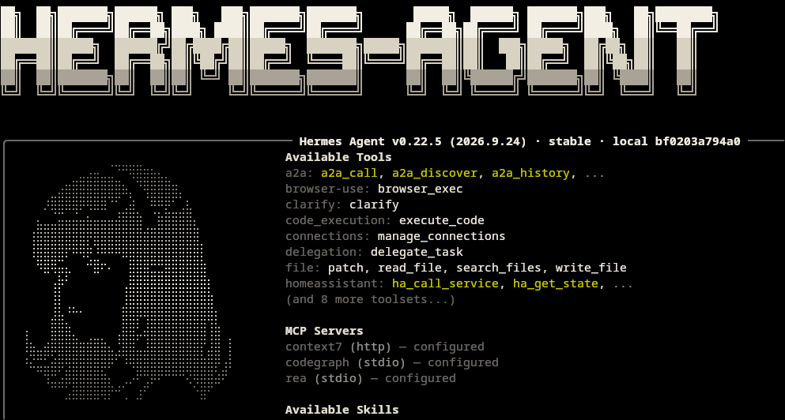
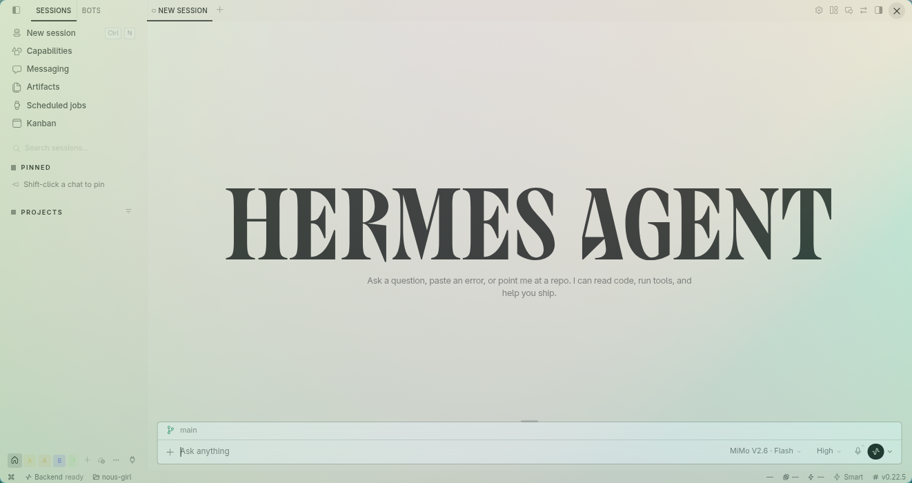
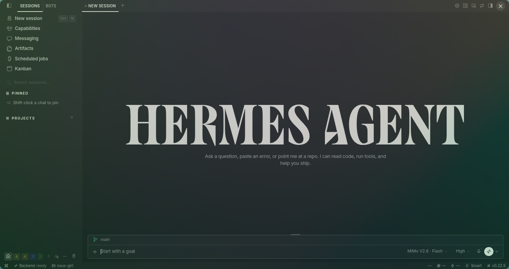

# Nous Girl

**Ink on paper in light mode, paper on ink in dark.** A monochrome theme for Hermes Desktop and the Hermes Agent CLI, named after the Nous Girl — the character the terminal banner draws in braille, painted from the theme's own palette instead of the built-in gold.



- **Two real palettes**, light and dark, in Hermes' native theme picker.
- **Matching CLI/TUI skins** (`nous-girl-light`, `nous-girl-dark`), each carrying the character and the wordmark as braille banner art.
- **Legible by measurement**: at least 4.5:1 contrast for text and 3:1 for controls, icons and focus states, against WCAG AA.
- **Colours only**: no fonts, no stylesheet, no DOM, no changes to Hermes core. Your typography and layout stay exactly as they are.

## Requirements

- Hermes Desktop and Hermes Agent `0.21.3` or newer.
- Read access to this repository. It is private, so the account running the install needs a credential: Hermes resolves an `https://` clone from `GITHUB_TOKEN` or from the `gh` CLI, which means an existing `gh auth login` on that account is enough.

## Install

```bash
hermes plugins install mykeura/nous-girl --enable
```

Reopen Hermes Desktop and select **Nous Girl** in the theme picker. The package is installed at `$HERMES_HOME/plugins/nous-girl-theme`; nothing is copied by hand. If the theme is missing or still shows an older description after an update, use **⌘K → Reload desktop plugins**.

Install only code you have reviewed. Plugins run in the Desktop process, so keep access to this repository in case you need to remove the package.

### The CLI skins need one copy step

Hermes only reads skins from `~/.hermes/skins/`, so the two skins that travel inside the plugin are not picked up on their own. Copy them once after installing, and again after every update:

```bash
mkdir -p ~/.hermes/skins
cp ~/.hermes/plugins/nous-girl-theme/skins/*.yaml ~/.hermes/skins/
hermes skin use nous-girl-dark
```

Confirm the version first: `hermes plugins list` should show the release you followed. Copying from an older install silently overwrites your skins with stale colours — there is no error and no warning. The path uses the plugin's manifest name, `nous-girl-theme`, not the repository directory name.

Inside a running session, `/skin nous-girl-dark` switches skins without leaving the TUI. Use `nous-girl-dark` on a black terminal: the light skin's dark ink is not legible there.

Choosing a CLI skin also moves the Desktop appearance, because `display.skin` is shared per profile. The Desktop theme keeps both palettes and picks the half that matches the app's own appearance setting, not the skin the terminal happens to be using.

## Switch back or remove

Select another Desktop theme to revert the interface. To disable or delete the package:

```bash
hermes plugins disable nous-girl-theme   # keep it installed, stop loading it
hermes plugins remove nous-girl-theme    # delete it
```

Do not edit or delete files inside Hermes core. If you copied the skins, remove them from `~/.hermes/skins/` as well.

## Preview

### Light mode



### Dark mode



## How it differs from the built-in Nous theme

Hermes ships a native theme called **Nous**. Nous Girl is an independent package, not a variant of it:

| | Nous (built in) | Nous Girl |
| --- | --- | --- |
| Palette | GitHub Light/Dark Default | Own palette, achromatic |
| Accent | Nous blue | None: hierarchy comes from value, not hue |
| Terminal | Built-in skin | Two skins with the character in braille |
| Type | Hermes fonts | Hermes fonts (unchanged) |

## Palette

| Role | Light | Dark |
| --- | --- | --- |
| Surface | `#E6E1D3` paper | `#141412` ink |
| Text | `#161512` ink | `#F2EEE3` bone |
| Focus / rules | `#161512` | `#F2EEE3` |
| Hairline border | `#55524B` | `#6E6B64` |
| Destructive | `#9E2F22` | `#BC4A3D` |

The interface is deliberately achromatic: hierarchy comes from value, not hue, so the palette stays calm next to code, diffs and terminal output.

The banner follows the same rule. Both skins ship `banner_hero` and `banner_logo`, and every ramp stop is a value from that skin's palette: the dark skin climbs from `#6E6B64` to `#F2EEE3` at the centre of the figure, the light skin from `#5F5B52` to `#161512`. Shipping both keys is not cosmetic — when a skin omits `banner_logo`, the CLI falls back to `HERMES_AGENT_LOGO`, whose colours are hardcoded to the built-in gold and ignore the active skin, which is why an unthemed wordmark keeps appearing next to themed art.

Release history is in [CHANGELOG.md](CHANGELOG.md).

## A small way to support the project

If you are considering the Nous Portal **Plus** plan, you can use [my Nous Portal referral link](https://portal.nousresearch.com/r/mykeura): your first month costs **$5 instead of $20**, and I receive a $10 referral credit that helps cover the API usage behind Nous Girl and my other Hermes plugins. It is optional and mutual — the discount applies to the first invoice of a new Plus subscription, and each payment card can back only one referral.

If you would rather support the work directly, you can [sponsor me on GitHub](https://github.com/sponsors/mykeura). Thank you.

## License

[MIT](LICENSE).
